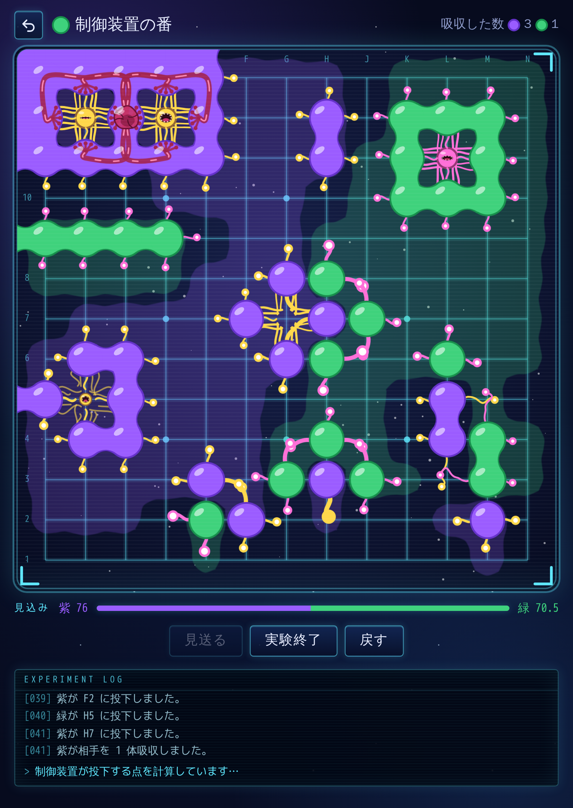
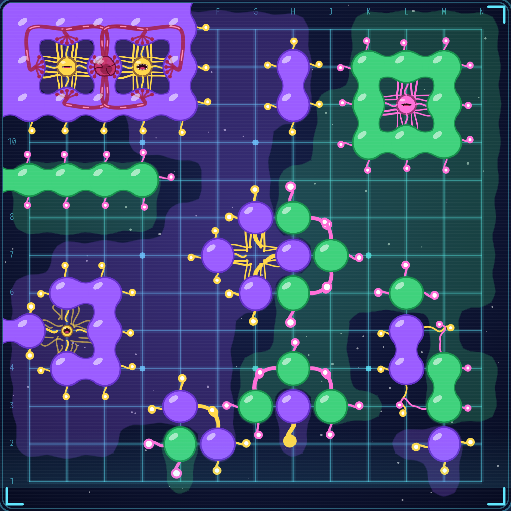

# 培養碁

囲碁の石を宇宙の生命体として描き、石の状態を触手や口、臓器の見た目で示すブラウザゲーム。ルールは囲碁と同じで、盤の見た目から石の状態が分かる。

**遊ぶ: https://iharuoru.github.io/baiyou-go/** (PC・スマホのブラウザ。インストール不要)

## 設定

遠い星で採取された紫と緑の 2 種の生命体は、ほかの個体を吸収して取り込む能力をもつ。より強力な種を選別するため、格子を刻んだ培養槽で 2 種を競わせ、どちらが培養槽を広く支配するかを調べる実験。実験者は一方の色を担当し、培養槽を広く支配させることを目指す。画面の文言は実験の設定に合わせ、囲碁の用語を使わない。

## 遊び方

1. 相手の制御 (制御装置 弱 / 中 / 強、または実験者 2 名で交互に)、担当する色、培養槽の大きさ (9 × 9 / 13 × 13 / 19 × 19) を選んで実験開始
2. 格子の点を押して生命体を投下する。カーソルを合わせると (スマホは 1 回目のタップで)、投下した後の触手が見える
3. 支配が広がらないと判断したら投下を見送る。両方の色が続けて見送ると実験終了。「実験終了」を押すと、押した側は以降をすべて見送る
4. 実験終了後、生命維持を解除された生命体が支配していた範囲へ染み出す。それを配管で回収してシリンダーで測り、量 (ml) の多い色がより強力な種と判定される (勝ち)。後から投下した緑には 75 ml の補正を足す (ルールは囲碁の中国ルール: 石と囲んだ範囲を数え、コミ 7.5 目、同形反復は禁止)
5. 結果は盤の画像付きで X にポストできる

スタート画面の「実験方法」「観察結果」に、図付きの説明がある。

## 盤の見方

| 見た目 | 意味 | 囲碁では |
|---|---|---|
| 同じ色の生命体が溶け合う | 1 つの群れ | 連 |
| 生命体から伸びる触手 (味方は黄色、相手はピンク) | 呼吸できる点。長く太く、先が大きいほど窒息が近い | 呼吸点 (ダメ)、アタリ |
| 群れの中心の、歯の並んだ大きな口 | 相手が入り込めない点 | 眼 |
| 触手のゆるんだ小さな口 / 口のない点 | 隙間が埋まりきっていない / 相手が入り込んだ | 未確定の眼 / 欠け目 |
| 群れの中の臓器と管 | 口を 2 つ持ち、吸収されない群れ | 二眼 (活き) |
| 交差して絡む触手 | 呼吸の場所の奪い合い / 互いに手出しできない共存 | 攻め合い / セキ |
| 斜めの間の点へ伸びて震える触手 | 相手に投下されると分断される点 | 切断点 |
| 吸収した点に居座る触手の網 | すぐには投下し返せない点 | コウ |
| 群れから染み出す液体 | 支配しそうな範囲 | 勢力 |
| 粒に崩れる生命体 | 吸収された / 実験終了の時点で取り残された | 取られた石 / 死に石 |

